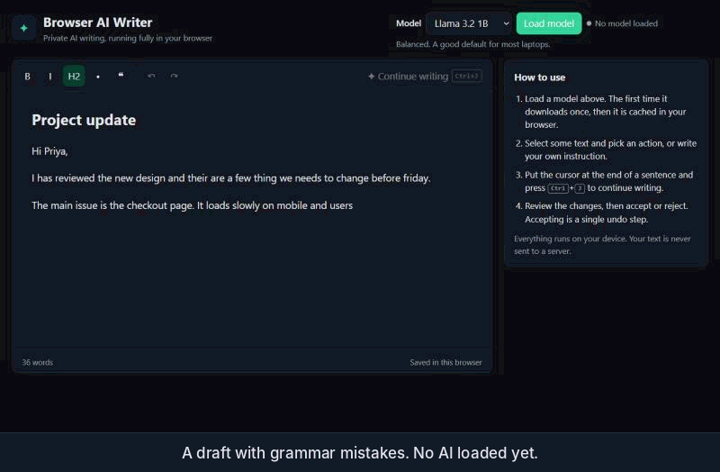

# Browser AI Writer

A private AI writing editor that runs a language model inside your browser.

No API key. No backend. No cost. Your text never leaves your device, and after the first download the model loads from the browser cache.

**Live demo:** https://browser-ai-writer.vercel.app (open in desktop Chrome or Edge)



_Recorded on the live site with Llama 3.2 1B running in the browser._

## What it does

- **Rewrite selected text.** Select text and pick Improve, Shorten, Fix grammar, Formal, Friendly, or type your own instruction.
- **Review before anything changes.** The suggestion streams into a side panel with a word-level diff (removed words in red, added words in green). You accept or reject it.
- **Continue writing.** Press `Ctrl+J` (`⌘J` on Mac) and the model writes the next sentences as gray "ghost text" at your cursor. `Tab` accepts, `Esc` dismisses.
- **Stop at any time.** `Esc` stops generation and keeps what was written so far for review.
- **Clean undo.** Accepting a suggestion is one undo step, no matter how many tokens were streamed.
- **Pick a model.** Four small open models, from fastest to best quality. Models are cached by the browser after the first download.
- **Autosave.** The document is saved in the browser automatically.
- **Light and dark mode**, keyboard shortcuts, and screen reader labels.

## How it works

```
React UI (main thread)                      Web Worker
─────────────────────                       ──────────
Tiptap editor                                WebLLM engine
  ├─ selection menu  ──┐                       ├─ downloads model (cached)
  ├─ ghost text        │   messages            ├─ runs it on the GPU (WebGPU)
  └─ highlight         ├──────────────────▶    └─ streams tokens back
useAISuggestion hook   │   token stream
  └─ reducer: idle → streaming → review ◀───┘
SuggestionPanel (diff, accept, reject, stop)
```

1. On start, the app checks if the browser supports WebGPU and if the GPU supports 16-bit shaders. Older GPUs get the 32-bit version of the model automatically.
2. When you load a model, the WebLLM runtime is loaded with a dynamic `import()`, so the first page load stays small.
3. The model runs inside a **Web Worker**, so typing and scrolling stay smooth while it generates.
4. AI output is never written straight into the document. It is shown with ProseMirror **decorations** (a highlight on the selected text, gray ghost text at the cursor). The document only changes when you accept.
5. While a suggestion is pending, the editor is locked so the selected range cannot move under it.

## Technical decisions

These are the trade-offs I made on purpose.

| Decision | Why | Trade-off |
| --- | --- | --- |
| Run the model in the browser | Zero cost, private by design, model cached after the first download | Small models write worse than GPT-class models. First download is large. |
| Web Worker for the engine | Generation never blocks the UI thread | A bit more setup |
| Decorations instead of inserting text while streaming | Undo history stays clean, rejecting is instant | Needed a custom ProseMirror plugin |
| Small `AIEngine` interface | The UI does not know about WebLLM, so tests use a fake engine, and a hosted API could replace it later | One extra layer |
| Pure reducer for suggestion state | Every state change is unit tested | None really |
| Output cleanup step | Small models often add "Here is the rewritten text:" even when told not to | Strict patterns, so real sentences are not removed |
| Own word-diff (LCS) instead of a library | Small, tested, and enough for short selections | Falls back to "all removed, all added" on very long text |
| Model output inserted as text nodes, never parsed as HTML | Prevents broken markup or injected HTML from model output | Rewriting a selection removes bold or italic inside it |

## Tech stack

React 18, TypeScript, Vite, Tiptap (ProseMirror), WebLLM, WebGPU, Web Workers, Vitest, React Testing Library, GitHub Actions.

## Getting started

You need Node.js 20 or newer.

```bash
npm install
npm run dev
```

Open the local URL in **desktop Chrome or Edge**. Pick a model, click **Load model**, and wait for the download to finish. The first load can take a few minutes depending on your connection. Later loads come from the browser cache.

### Scripts

| Command | What it does |
| --- | --- |
| `npm run dev` | Start the dev server |
| `npm run build` | Type check and build for production |
| `npm run preview` | Serve the production build locally |
| `npm test` | Run all tests once |
| `npm run typecheck` | Type check only |

## Browser support

- **Works:** recent desktop Chrome and Edge with WebGPU.
- **Might work:** other browsers as their WebGPU support improves.
- **Phones:** usually not. The app shows a clear message instead of failing silently.

### Troubleshooting

- **"This browser does not support WebGPU"**: use desktop Chrome or Edge and turn on hardware acceleration in browser settings.
- **Out of memory or the GPU stops responding**: pick a smaller model.
- **Download fails halfway**: check free disk space, then try again. The browser stores models in its cache storage.

## Tests

```bash
npm test
```

Covered:

- word diff (including that both texts can always be rebuilt from the diff)
- output cleanup and how continued text joins the existing sentence
- prompt building and model id selection
- every transition of the suggestion reducer
- the `useAISuggestion` hook with a fake streaming engine (success, failure, no engine, clear)
- the suggestion panel (diff rendering, accept, reject, stop, errors)

## Deploy

The app is fully static, so any free static host works.

- **Vercel:** import the repo. It detects Vite on its own. Build command `npm run build`, output folder `dist`.
- **Netlify:** same settings.
- **GitHub Pages:** set `base: "/<repo-name>/"` in `vite.config.ts`, then publish the `dist` folder.

## Known limitations

- Small local models are weaker than hosted models. Longer or tricky rewrites can miss the point, so the review step matters.
- Rewriting a selection replaces it with plain text, so formatting inside the selection is lost.
- Selections are limited to 4,000 characters to keep results usable on small models.

## Ideas for later

- Keep bold and italic when rewriting
- Optional hosted model for users without WebGPU
- Document list stored in IndexedDB
- Export to Markdown

## License

MIT
